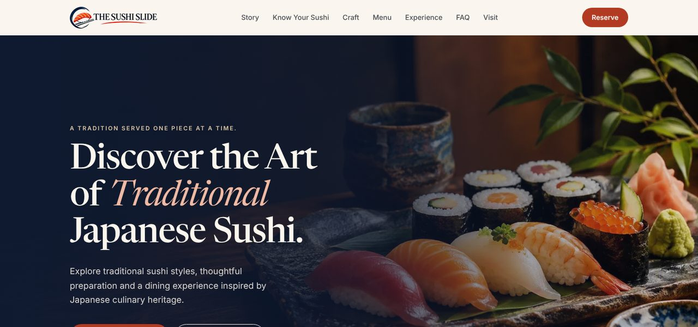
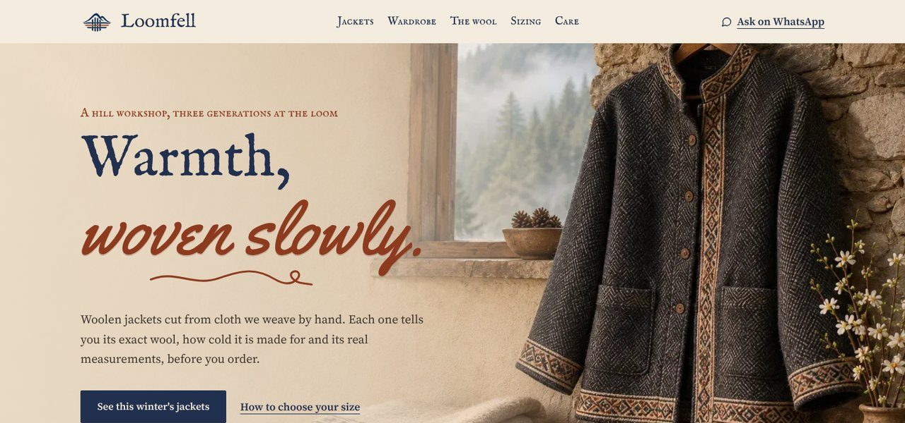
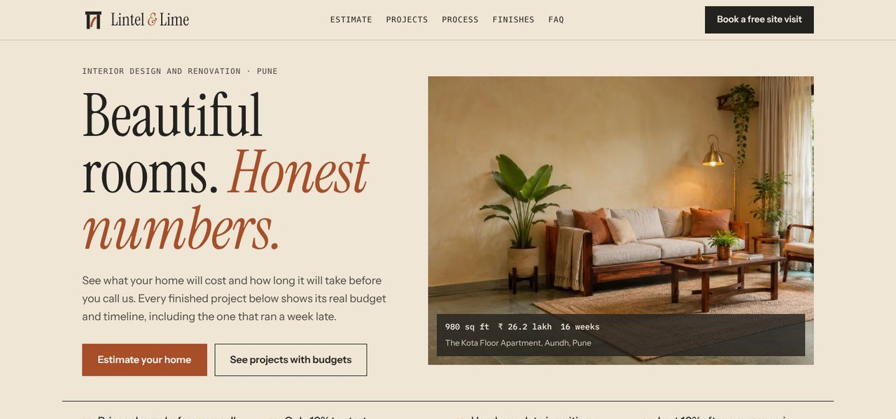
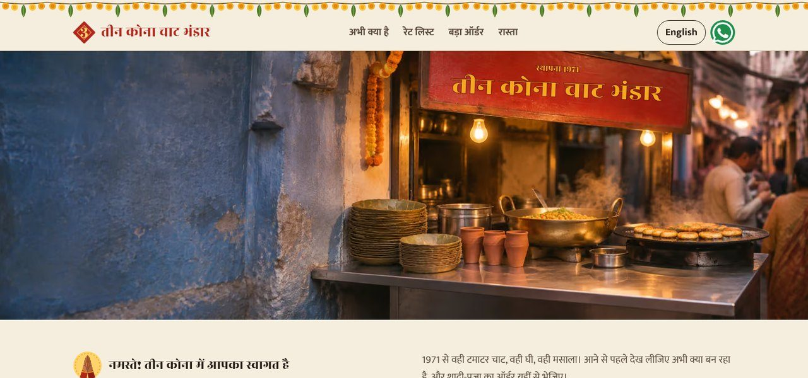
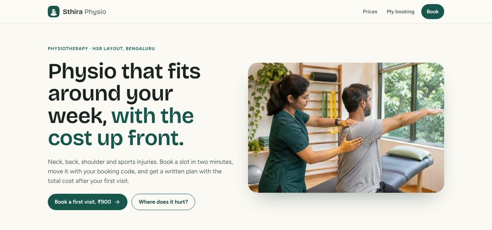

# Website design concepts

**A website should bring you customers, not just look good.**

Each website below was designed for a different kind of business, starting from the problem that stops its customers from buying, booking or visiting. Find the one closest to your business and open it on your phone.

**Want one for your business?** [Email vikassahani17@gmail.com](mailto:vikassahani17@gmail.com?subject=Website%20for%20my%20business&body=Hi%20Vikas%2C%0A%0AI%20run%20a%20%28type%20of%20business%29%20in%20%28city%29%20and%20saw%20your%20website%20concepts.%0A%0AWhat%20I%20need%20help%20with%3A%0A%0AThanks%2C%0A)

## Find a business like yours

| If you run… | Your customers often ask… | See this website |
|---|---|---|
| A **restaurant, café or cloud kitchen** | “What is this dish? What should I order?” | **[The Sushi Slide](https://the-sushi-slide.netlify.app)**: a guide to the food before the menu, and ready-made first orders |
| A **clothing, handmade or craft brand** | “Is it really what you say? Will it fit? Is it worth the price?” | **[Loomfell](https://loomfell-woolens.netlify.app)**: honest labels, feel and warmth explained, a size guide, orders on WhatsApp |
| A **service business with quotes**: interiors, renovation, contracting, events | “What will it cost? How long will it take? Can I trust you?” | **[Lintel & Lime](https://lintel-and-lime.netlify.app)**: a cost estimator, past projects with real numbers, payments by stage |
| A **local shop with regulars**: sweets, snacks, street food, kirana | “Are you open now? Can you cater my function? Where exactly are you?” | **[Teen Kona Chaat Bhandar](https://teen-kona-chaat.netlify.app)**: what’s on now, bulk orders on WhatsApp, directions, Hindi and English |
| An **appointment business**: clinic, salon, coaching, studio | “When can I come? What if I can’t make it? What will it cost?” | **[Sthira Physiotherapy](https://sthira-physio.netlify.app)**: online booking, move or cancel with a code, prices up front |

> All five businesses are fictional, made to show what a website can do. Their names, prices and contact details are invented, and each site says so. The customer problems they solve are real.

## What every website includes

- **Built around your customers’ questions**, so they decide faster and contact you ready to buy or book.
- **Fast on any phone**, even on a weak connection: most of these load their main content in about a second.
- **Orders, bookings and enquiries on WhatsApp**, with the message already written. No long forms.
- **Your look, not a template**: the design comes from your products, your shop and your city.
- **Easy to update**: your prices, menu, hours and photos sit in one place.
- **In your customers’ language**, including Hindi and English.

## Want a website like this for your business?

Tell me what kind of business you run and what your customers keep asking you. I’ll reply with the problems your website should solve first.

**[Email vikassahani17@gmail.com](mailto:vikassahani17@gmail.com?subject=Website%20for%20my%20business&body=Hi%20Vikas%2C%0A%0AI%20run%20a%20%28type%20of%20business%29%20in%20%28city%29%20and%20saw%20your%20website%20concepts.%0A%0AWhat%20I%20need%20help%20with%3A%0A%0AThanks%2C%0A)**

## How each website is made

1. **Find the problem.** What stops a customer from buying, booking or visiting? Research into what real customers of that kind of business struggle with.
2. **Turn every doubt into a feature.** A table maps each customer doubt to the part of the site that answers it.
3. **Design from the business itself.** The look comes from the product and its world: a woven border from the jacket cloth, a painted rate board from a Banaras chaat stall, an architect’s drawing sheet for an interior studio.
4. **Build it to work on a cheap phone.** Fast on a slow connection, readable without JavaScript where possible, usable with a keyboard, and calm for people who prefer reduced motion.
5. **Measure and test.** Speed measured on a throttled phone connection, every flow tested in a real browser, and a list of what a real owner should track after launch.

---

## 1. The Sushi Slide

**Restaurant · Problem:** guests who want to try traditional sushi can’t tell the styles apart, don’t know what’s in a dish, and feel unsure what to order.

**What the site does**
- **Know your sushi:** four styles explained with what each is, the key difference and how to eat it, plus a comparison table, placed *before* the menu.
- **First-visit orders:** three ready-made starter orders (gentle, vegetarian, curious) built from the menu data, so items and totals always match.
- **A menu that answers questions:** every dish lists ingredients, portion and dietary tags; the FAQ’s diet answers are generated from the same data.

**Key decision:** education comes before the menu, so the dish names already make sense when guests reach them.

**[Visit the website →](https://the-sushi-slide.netlify.app)**

---

## 2. Loomfell

**Hand-woven wool jacket workshop · Problem:** the product’s main advantage, the cloth, is exactly what a screen hides. Shoppers can’t feel it, judge its warmth or trust the fit, so they buy cheaper or return.

**What the site does**
- **A woven label on every jacket** with the exact wool blend and lining, because fibre labels are often wrong.
- **Feel meters and a warmth scale:** weight, softness, itch and drape, and warmth by temperature.
- **A pattern-sheet size guide:** pick a size and the jacket’s real measurements light up.
- **WhatsApp ordering** with the jacket and size already written, and the exchange policy right beside the button.

**Key decision:** the design is built from the product: the jackets’ woven border becomes the section divider, and the photos’ plaster wall becomes the page.

**Measured:** main content visible in 1.9 s on a throttled phone (down from 2.7 s after a performance pass).

**[Visit the website →](https://loomfell-woolens.netlify.app)**

---

## 3. Lintel & Lime

**Interior design and renovation studio · Problem:** published prices range from about ₹1,000 to over ₹6,000 per sq ft, and people fear advances taken for unfinished work, so Instagram followers rarely become clients.

**What the site does**
- **A cost estimator** using the studio’s own rates: price range, GST shown separately, timeline and stage payments, with a bar showing where the rate sits against published Indian prices.
- **Projects with real numbers:** size, cost, and planned versus actual weeks, including the one that ran late, and why.
- **3D visual against the built room:** a drag-to-compare slider over the same corner.
- **Payments tied to finished stages**, drawn step by step: 10% to start, the last 10% after the snag list is closed.

**Key decision:** numbers are the brand. Every figure is set like an architect’s drawing, and the honest late project earns more trust than a perfect record.

**Measured:** main content visible in about 1 s on a throttled phone, with 2 KB of JavaScript.

**[Visit the website →](https://lintel-and-lime.netlify.app)**

---

## 4. Teen Kona Chaat Bhandar

**Banaras chaat shop with a queue every evening · Problem:** the shop doesn’t lack customers. It loses wedding and puja orders that arrive as calls during the rush, visitors who come at the wrong hour, and tourists who can’t find the lane.

**What the site does**
- **What’s on now:** reads the Indian clock and the season, shows morning or evening service and switches winter-only dishes on and off.
- **Bulk order calculator:** guests, dishes, cooks needed, advance and notice period, sent as a complete written order on WhatsApp.
- **Pickup pre-orders** on WhatsApp, with time slots inside opening hours. No delivery app commission.
- **Directions from the ghat:** a painted map of the lanes where the route draws turn by turn as you scroll.

**Key decision:** Hindi first with a full English version, and no Hinglish in either. The look comes from the shop’s own street: a marigold toran, a painted signboard and a green rate board.

**Measured:** main content visible in 0.9 s (Hindi) and 0.7 s (English) on a throttled phone.

**[Visit the website →](https://teen-kona-chaat.netlify.app)**

---

## 5. Sthira Physiotherapy

**Physiotherapy clinic · Problem:** most physio patients miss at least one visit, mostly because they forget; patients hesitate over unknown total costs; and only about a third keep up their home exercises.

**What the site does**
- **Booking in two minutes:** problem area, a safety check that sends warning signs to a doctor first, clinic or home visit, and a slot picker fed by a live API.
- **A booking code** to move or cancel in two taps, with the 24-hour rule shown first, plus a calendar file with an alarm.
- **Prices up front** and a written plan with the total cost after the first visit.
- **A daily exercise checklist** and a **clinic view** of each therapist’s day for front-desk staff.

**Key decision:** a different stack for a different job. Booking is an application, so this one is built with Next.js, React and TypeScript; the content-led concepts use Astro.

**Measured:** main content visible in 0.65 s on a throttled phone.

**[Visit the website →](https://sthira-physio.netlify.app)**

---

## For technical readers: the stack follows the problem

| When the site is mainly… | Chosen | Why |
|---|---|---|
| Content: menus, products, stories, prices | **Astro** | Plain, fast HTML with only the JavaScript a feature needs |
| An application: bookings, accounts, dashboards | **Next.js** (React, TypeScript) | Multi-step state, server routes and app-like pages in one codebase |
| A shop with checkout and inventory | Shopify | Payments and stock management are already solved |
| Content the owner edits every week | Astro or Next.js with a CMS | The owner edits text, not code |

## Standards in every concept

- **Honest content:** no invented reviews, ratings or awards; fictional details labelled; no fake phone numbers.
- **Built for real phones:** tested at 360 to 390 px wide, measured on a slow connection, images in AVIF and WebP, fonts cut down to the characters used.
- **Accessible:** keyboard-friendly controls, visible focus, alt text on every image, reduced motion respected.
- **One action, no forms:** orders and enquiries end in a pre-written WhatsApp message or a booking, never a long form.
- **Ready to hand over:** each site keeps its business details in one or two data files, so it can be adapted for a real owner without touching the design.

---

**Want a website like these for your business?** [Email vikassahani17@gmail.com](mailto:vikassahani17@gmail.com?subject=Website%20for%20my%20business&body=Hi%20Vikas%2C%0A%0AI%20run%20a%20%28type%20of%20business%29%20in%20%28city%29%20and%20saw%20your%20website%20concepts.%0A%0AWhat%20I%20need%20help%20with%3A%0A%0AThanks%2C%0A)
